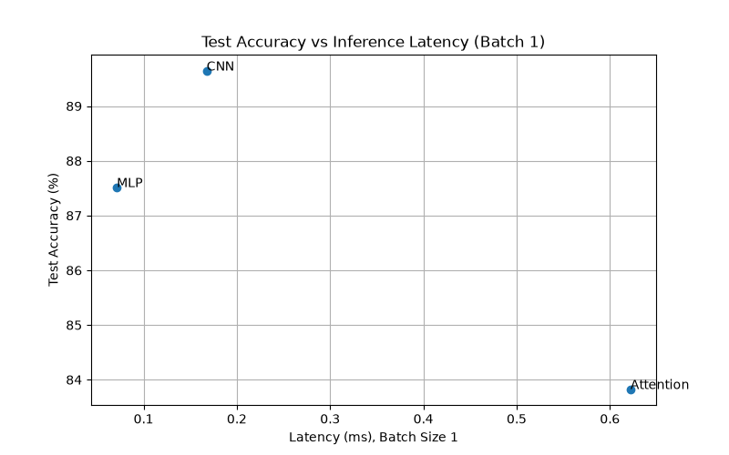
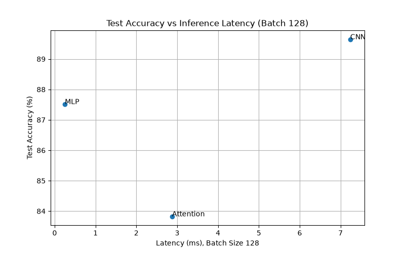

# Lab 3 — Architectures and Their Costs

## 1. Introduction

The goal of this laboratory assignment is to compare three neural network architectures: a Multi-Layer Perceptron (MLP), a Convolutional Neural Network (CNN), and an Attention-based model (a small Vision-Transformer-style encoder).

All models were trained and evaluated on Fashion-MNIST. The comparison focuses on parameter count, test accuracy, hand-calculated and profiled computational cost (FLOPs), inference latency, and data access patterns.

## 2. Dataset

Fashion-MNIST contains grayscale clothing images with a resolution of 28 × 28 pixels and 10 classes.

| Dataset    | Number of images |
|------------|-----------------:|
| Training   | 55,000           |
| Validation | 5,000            |
| Testing    | 10,000           |

- The official 60k training set was split into 55k training and 5k validation images (`random_split`, generator seed 42).
- The official 10k test set was used only for the final test accuracy.
- Batch size: 128
- Transform: `ToTensor()` and `Normalize((0.2860,), (0.3530,))`

## 3. Experimental Setup

The models were implemented in Python with PyTorch and run on a CPU.

- Optimizer: Adam
- Learning rate: 0.001
- Epochs: 5
- Loss function: CrossEntropyLoss
- Parameter inspection: `torchinfo.summary`
- Computational cost profiling: `thop.profile`
- Latency measurement: `time.perf_counter`, model in `eval()` mode, `torch.no_grad()`, 10 warm-up forward passes, then the **median** of 100 runs (batch size 1) and 20 runs (batch size 128).

Note: the random seed (42) was fixed only for the train/validation split, not for model weight initialization. Latency values depend on the machine and vary slightly between runs.

### 3.1. Model Definitions

- **MLP:** Flatten 784 → Linear 256 → ReLU → Linear 128 → ReLU → Linear 10.
- **CNN:** Conv2d(1, 16, 3, padding=1) → ReLU → MaxPool2d(2) → Conv2d(16, 32, 3, padding=1) → ReLU → MaxPool2d(2) → Flatten (32 × 7 × 7) → Linear(1568, 10).
- **Attention:** the 28 × 28 image is split into 16 patches of 7 × 7 (Conv2d with kernel 7 and stride 7, projecting to d_model = 64), followed by two Transformer encoder layers (`d_model=64`, `nhead=4`, `dim_feedforward=128`), mean pooling over the 16 patch tokens, and a Linear(64, 10) classifier.

## 4. Experimental Results

### 4.1. Model Parameters

The parameter counts were obtained with `torchinfo.summary`.

| Model     | Trainable Parameters |
|-----------|---------------------:|
| MLP       | 235,146              |
| CNN       | 20,490               |
| Attention | 70,794               |

The layer-by-layer breakdown:

| Model     | Breakdown |
|-----------|-----------|
| MLP       | 200,960 (784→256) + 32,896 (256→128) + 1,290 (128→10) |
| CNN       | 160 (Conv 1→16) + 4,640 (Conv 16→32) + 15,690 (Linear 1568→10) |
| Attention | 3,200 (patch projection) + 2 × 33,472 (encoder layers) + 650 (classifier) |

Each Attention encoder layer contains 12,480 (attention input projection) + 4,160 (attention output projection) + 8,320 and 8,256 (two feed-forward linear layers) + 256 (two LayerNorms) = 33,472 parameters.

**Note on model size:** The assignment targets roughly 100k–150k parameters per model ("similar size"). However, the architectures specified in the assignment produce different sizes (for example, 784→256→128→10 alone has about 235k parameters, and the specified CNN has only about 20k). The specified architectures were implemented without modification, so the three models are **not** of similar size. The accuracy-versus-parameters comparison should be interpreted with this in mind.

### 4.2. Test Accuracy

| Model     | Test Accuracy |
|-----------|--------------:|
| MLP       | 87.52%        |
| CNN       | 89.65%        |
| Attention | 83.83%        |

The CNN achieved the highest test accuracy (89.65%). Each model was trained once, so the differences are single-run results.

### 4.3. Inference Latency

| Model     | Batch Size 1 (ms) | Batch Size 128 (ms) |
|-----------|------------------:|--------------------:|
| MLP       | 0.0713            | 0.2511              |
| CNN       | 0.1676            | 7.2368              |
| Attention | 0.6220            | 2.8753              |

The MLP has the lowest latency for both batch sizes. The Attention model is the slowest at batch size 1, and the CNN is the slowest at batch size 128.

### 4.4. Computational Cost: MACs and FLOPs

One MAC is one multiply-accumulate operation. Following the assignment formulas, FLOPs are counted as 2 × MACs.

| Model     | Manual MACs | Manual FLOPs | THOP MACs | THOP FLOPs (2 × MACs) |
|-----------|------------:|-------------:|----------:|----------------------:|
| MLP       | 234,752     | 469,504      | 234,752   | 469,504               |
| CNN       | 1,031,744   | 2,063,488    | 1,031,744 | 2,063,488             |
| Attention | 1,164,928   | 2,329,856    | 591,488   | 1,182,976             |

The manual calculations match THOP exactly for the MLP and the CNN. For the Attention model, THOP reports about half of the manual value (explained in Section 4.5).

#### Manual FLOPs Calculation: MLP

For a fully connected layer: FLOPs = 2 × Input × Output.

- Linear 784 → 256: 2 × 784 × 256 = 401,408 FLOPs
- Linear 256 → 128: 2 × 256 × 128 = 65,536 FLOPs
- Linear 128 → 10: 2 × 128 × 10 = 2,560 FLOPs

Total: 401,408 + 65,536 + 2,560 = **469,504 FLOPs** (234,752 MACs).

#### Manual FLOPs Calculation: CNN

For a convolutional layer: FLOPs = 2 × K × K × C_in × C_out × H_out × W_out.

- Conv2d 1 → 16 (28 × 28 output): 2 × 3 × 3 × 1 × 16 × 28 × 28 = 225,792 FLOPs
- Conv2d 16 → 32 (14 × 14 output): 2 × 3 × 3 × 16 × 32 × 14 × 14 = 1,806,336 FLOPs
- Linear 1568 → 10: 2 × 1,568 × 10 = 31,360 FLOPs

Total: 225,792 + 1,806,336 + 31,360 = **2,063,488 FLOPs** (1,031,744 MACs).

ReLU and max-pooling are not counted.

#### Manual FLOPs Calculation: Attention

The 28 × 28 image is divided into (28 / 7)² = 16 patches (sequence length = 16). The embedding dimension is d_model = 64, the feed-forward dimension is 128, and there are two encoder layers.

Per encoder layer (in MACs):

| Operation | Formula | MACs |
|-----------|---------|-----:|
| Q, K, V projections | 3 × 16 × 64 × 64 | 196,608 |
| Attention scores (QKᵀ) | 16² × 64 | 16,384 |
| Attention-weighted values | 16² × 64 | 16,384 |
| Output projection | 16 × 64 × 64 | 65,536 |
| Feed-forward network | 16 × 64 × 128 + 16 × 128 × 64 | 262,144 |
| **Total per layer** | | **557,056** |

Two encoder layers: 2 × 557,056 = 1,114,112 MACs.
Patch projection: 16 × 49 × 64 = 50,176 MACs.
Classifier: 64 × 10 = 640 MACs.

Total: 1,114,112 + 50,176 + 640 = **1,164,928 MACs**, i.e. **2,329,856 FLOPs**.

In FLOPs, the individual terms are: Q, K, V projection 2 × 16 × 64 × 3 × 64 = 393,216; attention scores 2 × 16² × 64 = 32,768; weighted values 2 × 16² × 64 = 32,768.

This manual estimate counts the main matrix multiplications. It excludes softmax, LayerNorm, residual additions, bias additions and activations.

### 4.5. Gap Between the Manual Calculation and THOP (Attention)

THOP reports 591,488 MACs for the Attention model, while the manual calculation gives 1,164,928 MACs. The numbers show that THOP does not count the operations inside `nn.MultiheadAttention`: the Q/K/V projections, the attention scores (QKᵀ), the attention-weighted values and the output projection. These operations account for 196,608 + 16,384 + 16,384 + 65,536 = 294,912 MACs per encoder layer, i.e. 589,824 MACs for two layers.

Checking this against the THOP total:

- Counted by THOP: feed-forward layers (2 × 262,144 = 524,288) + patch projection (50,176) + classifier (640) = 575,104 MACs.
- THOP reports 591,488 MACs, so there are 16,384 additional MACs, which most likely come from small element-wise operations such as LayerNorm that THOP counts but the manual calculation excludes.

The same effect appears in the parameter count: `torchinfo` reports 70,794 parameters, while THOP reports only 37,514. The difference, 33,280, equals the attention input and output projection parameters of the two encoder layers: 2 × (12,480 + 4,160) = 33,280.

Therefore, for the Attention model, the manual calculation is the more reliable estimate of the computational cost, and the `torchinfo` value is used as the parameter count.

## 5. Graphical Results

### 5.1. Test Accuracy vs Model Parameters

The CNN achieved the highest accuracy with the fewest parameters. The MLP has about 11 times more parameters than the CNN but a lower accuracy. The Attention model lies in between in parameter count and has the lowest accuracy.

### 5.2. Test Accuracy Comparison

The CNN achieved 89.65% test accuracy, followed by the MLP with 87.52% and the Attention model with 83.83%.

### 5.3. Inference Latency — Batch Size 1

The MLP achieved the lowest latency, while the Attention model had the highest.

### 5.4. Inference Latency — Batch Size 128

The MLP achieved the lowest latency, while the CNN had the highest.

### 5.5. Test Accuracy vs Inference Latency

At batch size 1, the CNN gives the highest accuracy at a low latency (0.17 ms), while the Attention model is both the slowest and the least accurate. At batch size 128, the MLP is the fastest, the CNN is the slowest but the most accurate, and the Attention model lies in between in latency. In these experiments, the Attention model is never the best choice in either accuracy or latency.

## 6. Architecture and Data Access Patterns

### 6.1. MLP

The MLP flattens each image into a 784-value vector and multiplies it with dense weight matrices. Every weight is used exactly once per input image, so there is no weight reuse within a sample, and the number of parameters (235,146) is close to the number of MACs (234,752). The access pattern is regular and contiguous (dense matrix–vector or matrix–matrix products), which is very efficient on a CPU. This explains why the MLP has the lowest latency at both batch sizes. However, it ignores the 2-D structure of the image, which limits its accuracy (87.52%).

### 6.2. CNN

The CNN applies small 3 × 3 filters to local image regions. The same filter weights are reused at every spatial position (weight sharing), so the model needs few parameters (20,490) but performs many operations (1,031,744 MACs, about 50 MACs per parameter). The data accesses are local: each output reads only a small neighbourhood of the input, which gives good data locality and an inductive bias that suits images. This explains the highest accuracy (89.65%) with the fewest parameters. The cost is a high arithmetic workload and large intermediate feature maps (16 × 28 × 28 after the first convolution) that must be written and read through memory, which is a likely reason for the high latency at batch size 128.

### 6.3. Attention

The Attention model splits the image into 16 patches and lets every patch attend to every other patch. Weights are reused across the 16 tokens, but the attention step requires global, all-to-all data access between tokens, and it adds extra operations (softmax, LayerNorm, residual connections, several small matrix multiplications). Its cost grows quadratically with the sequence length (the 16 × 16 attention matrix), which is small here but would become dominant for longer sequences. The model also has no positional encoding and was trained for only 5 epochs, which is a likely reason for its lower accuracy (83.83%). At batch size 1, the many small operations make it the slowest model (0.62 ms).

### 6.4. Batch Size Effect

At batch size 1, the models are tiny and the latency is probably dominated by fixed per-call overhead (operator dispatch, memory allocation), so latency does not follow the FLOP count (the MLP is about 2.3× faster than the CNN, although the CNN has about 4.4× the FLOPs). At batch size 128, the actual arithmetic and memory traffic dominate, so the models are ordered by compute and data movement, and the CNN becomes the slowest. Larger batches also allow weights to be reused across samples, which is why the per-sample cost drops for every model.

## 7. Conclusion

This experiment compared MLP, CNN, and Attention-based architectures on Fashion-MNIST.

**Most cost-effective model: CNN.** It achieved the highest test accuracy (89.65%) with the fewest parameters (20,490), so it gives the best accuracy per parameter. Weight sharing and local data access make it parameter-efficient and well suited to images. The MLP is the fastest model and is the better choice when low latency at large batch sizes is the main requirement, but it needs about 11 times more parameters for a lower accuracy (87.52%). The Attention model had the lowest accuracy (83.83%) and the highest latency at batch size 1, so in this setup its extra computation and global data access are not justified.

Two limitations should be kept in mind: the three models are not of similar size (see the note in Section 4.1), and the results come from a single training run and a single latency measurement on one CPU. Also, THOP does not count the operations inside `nn.MultiheadAttention`, so its Attention estimate is about half of the manual value (Section 4.5).

Overall, architecture selection involves balancing accuracy, parameter count, computational cost, and inference latency.

## 8. Files in This Repository

- `models.py` — MLP, CNN and Attention model definitions
- `main.py` — data loading, training and testing (writes `results.txt`)
- `benchmark.py` — `torchinfo` and `thop` profiling (output in `benchmark_output.txt`)
- `measure.py` — latency measurement (output in `latency_output.txt`)
- `plots.py` — all plots
- `hand_calculations.jpg` — handwritten FLOP calculations
- `results.txt` — test accuracies
- `report.md` — this report