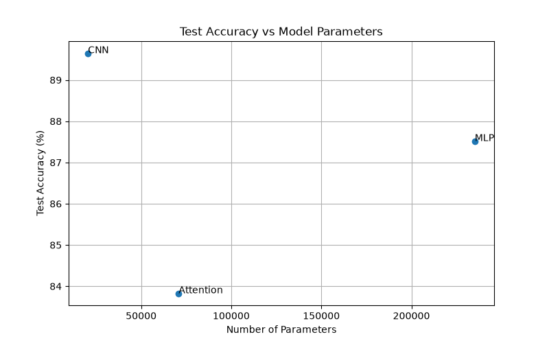
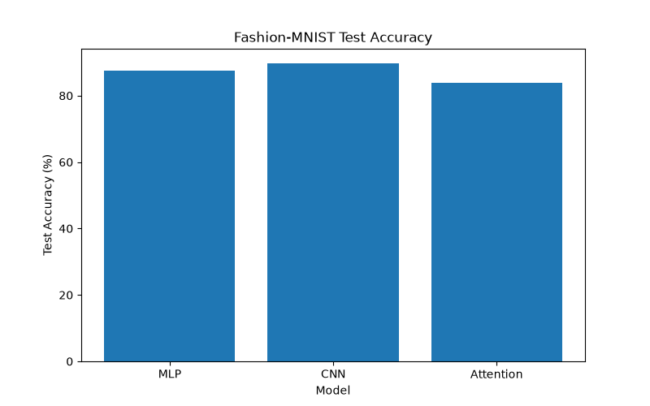
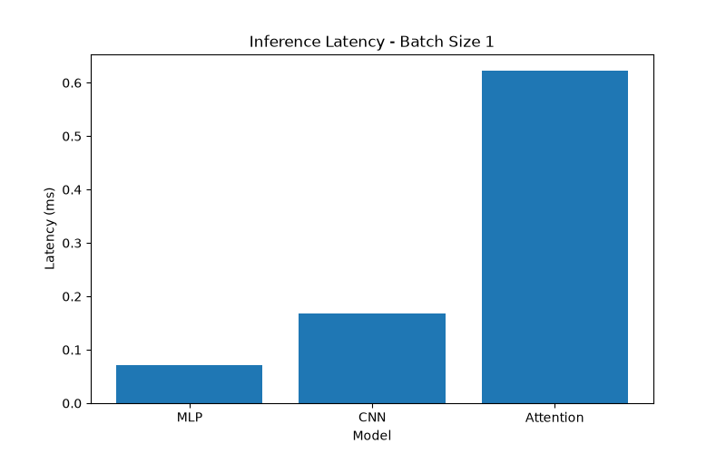
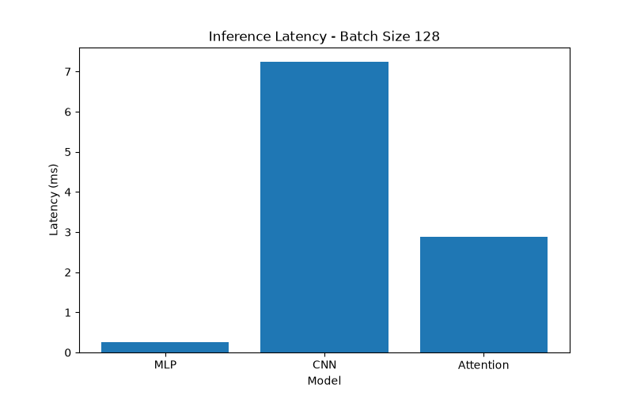

# Lab 3 — Architectures and Their Costs

## 1. Introduction

The goal of this laboratory assignment is to compare three neural network architectures: Multi-Layer Perceptron (MLP), Convolutional Neural Network (CNN), and an Attention-based model.

The models were evaluated using the Fashion-MNIST dataset. The comparison focuses on model parameters, test accuracy, inference latency, computational cost, and data access patterns.

## 2. Dataset

Fashion-MNIST contains grayscale clothing images with a resolution of 28 × 28 pixels.

| Dataset | Number of images |
|---|---:|
| Training | 55,000 |
| Validation | 5,000 |
| Testing | 10,000 |

Batch size: 128

Normalization:
- Mean: 0.2860
- Standard deviation: 0.3530

## 3. Experimental Environment

The models were implemented using Python and PyTorch and evaluated on a CPU.

- Optimizer: Adam
- Learning rate: 0.001
- Epochs: 5
- Loss function: CrossEntropyLoss
- Parameter inspection: torchinfo
- Computational cost: THOP

Inference latency was measured for batch sizes 1 and 128. Median timings were obtained from 100 runs for batch size 1 and 20 runs for batch size 128.

## 4. Experimental Results

### 4.1. Model Parameters

The parameter counts were obtained using `torchinfo.summary`.

| Model | Trainable Parameters |
|---|---:|
| MLP | 235,146 |
| CNN | 20,490 |
| Attention | 70,794 |

The MLP has the most parameters, while the CNN has the fewest.

### 4.2. Test Accuracy

| Model | Test Accuracy |
|---|---:|
| MLP | 87.52% |
| CNN | 89.65% |
| Attention | 83.83% |

The CNN achieved the highest test accuracy at 89.65%.

### 4.3. Inference Latency

| Model | Batch Size 1 (ms) | Batch Size 128 (ms) |
|---|---:|---:|
| MLP | 0.0713 | 0.2511 |
| CNN | 0.1676 | 7.2368 |
| Attention | 0.6220 | 2.8753 |

The MLP achieved the lowest latency for both batch sizes. The Attention model had the highest latency for batch size 1, while the CNN had the highest latency for batch size 128.

### 4.4. Computational Cost: MACs and FLOPs

One MAC represents a multiply-accumulate operation. For this comparison, estimated FLOPs are calculated as approximately twice the MAC count.

| Model | THOP MACs | Estimated FLOPs |
|---|---:|---:|
| MLP | 234,752 | 469,504 |
| CNN | 1,031,744 | 2,063,488 |
| Attention | 591,488 | 1,182,976 |

#### Manual FLOPs Calculation: MLP

For a fully connected layer:

FLOPs ≈ 2 × Input × Output

First layer:

2 × 784 × 256 = 401,408 FLOPs

Total MACs for all three fully connected layers:

784 × 256 + 256 × 128 + 128 × 10 = 234,752 MACs

Estimated total:

234,752 × 2 = **469,504 FLOPs**

#### Manual FLOPs Calculation: CNN

For a convolutional layer:

FLOPs ≈ 2 × Hout × Wout × Cout × Cin × Kh × Kw

First convolution:

2 × 28 × 28 × 16 × 1 × 3 × 3 = 225,792 FLOPs

Second convolution:

2 × 14 × 14 × 32 × 16 × 3 × 3 = 1,806,336 FLOPs

Final fully connected layer:

2 × 1,568 × 10 = 31,360 FLOPs

Total:

225,792 + 1,806,336 + 31,360 = **2,063,488 FLOPs**

These manual calculations match the THOP MAC-based estimates for the MLP and CNN.

#### Manual FLOPs Calculation: Attention

The 28 × 28 image is divided into 16 patches of size 7 × 7. The embedding dimension is 64, and the model has two Transformer encoder layers.

Q, K and V projections per encoder layer:

3 × 16 × 64 × 64 = 196,608 MACs

Attention scores per encoder layer:

16 × 16 × 64 = 16,384 MACs

Attention-weighted values per encoder layer:

16 × 16 × 64 = 16,384 MACs

Output projection per encoder layer:

16 × 64 × 64 = 65,536 MACs

Feed-forward network per encoder layer:

16 × 64 × 128 + 16 × 128 × 64 = 262,144 MACs

Total per encoder layer:

196,608 + 16,384 + 16,384 + 65,536 + 262,144 = 557,056 MACs

For two encoder layers:

2 × 557,056 = 1,114,112 MACs

Patch projection:

16 × 49 × 64 = 50,176 MACs

Classifier:

64 × 10 = 640 MACs

Approximate total:

1,114,112 + 50,176 + 640 = 1,164,928 MACs

Estimated FLOPs:

1,164,928 × 2 = **2,329,856 FLOPs**

This manual estimate counts the main matrix multiplications and excludes operations such as softmax, normalization and bias additions. THOP reports 591,488 MACs for the Attention model, so its reported value does not represent all operations included in this manual estimate.

The Attention parameter count is reported using `torchinfo` (70,794), because THOP reports only 37,514 parameters for this model.

## 5. Graphical Results

### 5.1. Test Accuracy vs Model Parameters

This graph compares model accuracy with parameter count. The CNN achieved the highest accuracy with the fewest parameters.

### 5.2. Test Accuracy Comparison

The CNN achieved 89.65% test accuracy, followed by the MLP at 87.52% and Attention at 83.83%.

### 5.3. Inference Latency — Batch Size 1

The MLP achieved the lowest latency, while the Attention model had the highest.

### 5.4. Inference Latency — Batch Size 128

The MLP achieved the lowest latency, while the CNN had the highest.

## 6. Architecture and Data Access Patterns

### 6.1. MLP

The MLP flattens each image into a vector of 784 values and processes it through fully connected layers. Each neuron connects to all neurons in the previous layer, providing a global connection pattern. The MLP achieved the lowest inference latency in these experiments.

### 6.2. CNN

The CNN applies convolutional filters to local image regions. Weight sharing allows the same filter to be used across different image locations, reducing the number of parameters. The CNN achieved the highest test accuracy.

### 6.3. Attention

The Attention model divides the image into patches and processes their relationships using Transformer encoder layers. Self-attention allows patches to interact globally. Its inference latency was higher than the MLP's for batch size 1.

## 7. Conclusion

This experiment compared MLP, CNN, and Attention-based architectures using Fashion-MNIST.

The CNN achieved the highest test accuracy at 89.65%. The MLP had the lowest inference latency for both batch sizes. The Attention model captured relationships between image patches, but its measured performance and THOP estimates should be interpreted with the limitations of Transformer operation counting in mind.

Overall, architecture selection involves balancing accuracy, parameter count, computational cost, and inference latency.